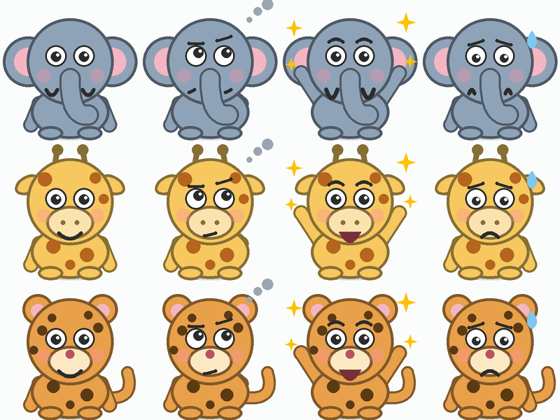

# Buddies and onboarding

## Why a buddy
Young learners stay with practice longer when a friendly character reacts to what they do, and
encouragement after a mistake matters most. The buddy celebrates correct answers, says "not quite yet"
after wrong ones, and cheers when a skill is mastered. It never scolds and never uses red or a buzzer.

## The buddies
Tembo (elephant), Twiga (giraffe), Chui (leopard): Swahili animal names, three silhouettes, four moods
(happy, thinking, cheer, oops). They are drawn in code with `CustomPainter` (`lib/mascot/mascot.dart`):
offline, a few kilobytes, no art licences, and every colour follows the same 100x100 coordinate box.

*The image is a Python mirror of the painter used to eyeball the geometry. The real thing is rendered by Flutter.
Check it for real in Settings -> Picture gallery -> Buddies and moods.*

## Onboarding (three screens)
1. Welcome: "Jambo! Karibu Hesabu", what the app is.
2. How it works: four steps (Recall, Explain, Use it, Think), hints are friends, mastery unlocks the next skill.
3. Choose a buddy and a nickname.

Skip is always available and uses defaults (Tembo, "Champion"). Settings has "Show the welcome again".

## Privacy rules (do not break these)
- No real name, email, phone, photo or account. The nickname is a label, not an identity.
- Nickname: at most 16 characters; letters, digits, space, apostrophe, hyphen (`sanitizeNickname`).
- Buddy and nickname are stored with `shared_preferences` on the device only and are never sent anywhere.
- If sync is added later it must be opt-in, parent/teacher-controlled, and must not upload the nickname by default.

## Accessibility
- The buddy has a text description for screen readers, for example "Twiga the giraffe, looking cheerful".
- The hop animation stops when the system asks for reduced motion.
- Page indicator and buddy cards announce their state ("Page 2 of 3", "selected").

## Adding a buddy
Add a value to `MascotKind` (name, animal, tagline, colour), add its ears/features in `_behind` and `_front`,
and add a gallery entry and a test. Keep the face drawing shared so every buddy has all four moods.
